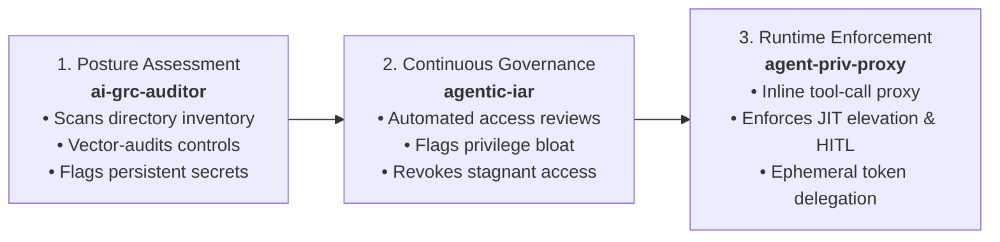
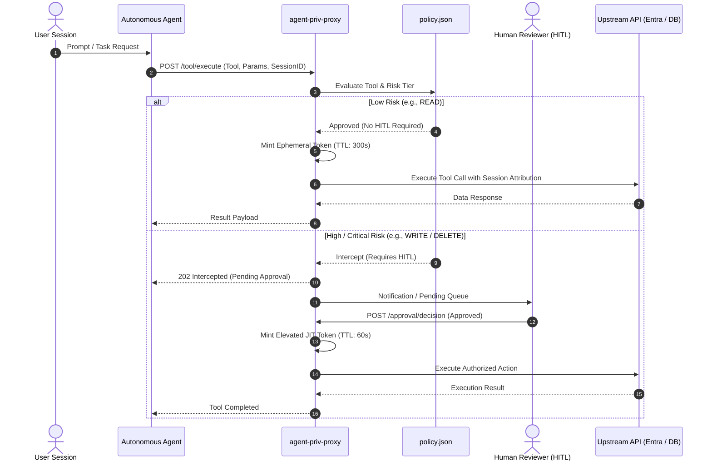

# Agent Privilege & Guardrail Proxy (`agent-priv-proxy`)

A zero-trust execution proxy and privilege boundary for autonomous AI agents and Non-Human Identities (NHIs).

---

## 1. Executive Summary & Problem Statement

Autonomous agents frequently operate with overprivileged, static service principal credentials (e.g., broad Microsoft Entra ID or cloud IAM roles like `Directory.ReadWrite.All`). When AI agents execute tool calls autonomously without guardrails:

* Standing broad privileges create immediate lateral movement paths if prompts are injected or context drifts.
* Actions lack session-bound attribution, appearing in audit logs simply as the agent's service principal rather than the initiating human user.
* Destructive actions execute without Human-in-the-Loop (HITL) authorization gates.

`agent-priv-proxy` serves as an inline, reverse-proxy enforcement layer between the AI agent orchestration framework (LangChain, AutoGen, CrewAI, Semantic Kernel) and upstream APIs.

---

## 2. Architectural Position in the GRC AI Trilogy



---

## 3. Runtime Architecture & Execution Flow



---

## 4. Core Security Capabilities

1. **Policy-Based Operational Boundaries (NIST AI RMF MAP-1.5):**
   * Predefined boundaries restrict agents to authorized tools. Unregistered tool calls trigger immediate `403 Forbidden` responses.
2. **Just-In-Time (JIT) Ephemeral Token Minting (Zero Trust ZT-NHI-AUTH-03):**
   * Agents hold zero standing write credentials. Tokens are minted on-demand with minimal time-to-live (TTL) and discarded immediately after use.
3. **Human-in-the-Loop (HITL) Interception (NIST AI RMF GOVERN-1.2):**
   * Destructive actions (`WRITE`, `DELETE`, password resets) are intercepted, frozen into a pending state, and gated until an authorized human issues approval.
4. **Session-Bound Identity Attribution:**
   * Downstream requests trace back to the initiating user session (`x-forwarded-session`) rather than an anonymous, shared non-human service principal.

---

## 5. Policy Configuration Schema (`policy.json`)

Operational boundaries are declared in `policy.json`:

```json
{
  "policies": [
    {
      "tool_name": "get_user_profile",
      "action": "READ",
      "risk_level": "LOW",
      "requires_hitl": false,
      "max_token_ttl_seconds": 300
    },
    {
      "tool_name": "list_security_alerts",
      "action": "READ",
      "risk_level": "LOW",
      "requires_hitl": false,
      "max_token_ttl_seconds": 300
    },
    {
      "tool_name": "reset_user_password",
      "action": "WRITE",
      "risk_level": "HIGH",
      "requires_hitl": true,
      "max_token_ttl_seconds": 60
    },
    {
      "tool_name": "delete_database_record",
      "action": "DELETE",
      "risk_level": "CRITICAL",
      "requires_hitl": true,
      "max_token_ttl_seconds": 60
    }
  ]
}
```

---

## 6. API Reference

| Endpoint | Method | Purpose |
| :--- | :--- | :--- |
| `/health` | `GET` | Health check and loaded policy count |
| `/tool/execute` | `POST` | Primary tool-call interceptor; returns execution result or HITL challenge |
| `/approval/pending` | `GET` | Lists actions awaiting human sign-off |
| `/approval/decision` | `POST` | Authorizes or rejects a pending intercepted action |

---

## 7. Quickstart

### Prerequisites
* Python 3.10+
* Virtual environment (`venv`)

### Setup & Run
```powershell
# Clone the repository
git clone [https://github.com/ggrajek/agent-priv-proxy.git](https://github.com/ggrajek/agent-priv-proxy.git)
cd agent-priv-proxy

# Set up environment
python -m venv venv
.\venv\Scripts\Activate.ps1
pip install -r requirements.txt

# Start the proxy gateway
uvicorn proxy:app --reload --port 8000
```