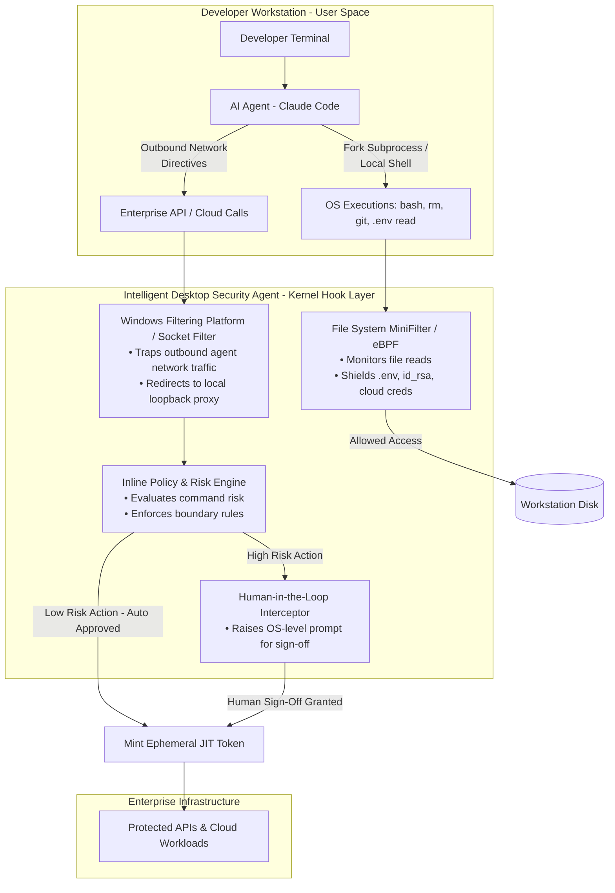

# Desktop AI Command Proxy Architecture (`desktop-proxy-arch.md`)

A kernel- and endpoint-mediated execution boundary for local AI developer agents (e.g., Claude Code, Cursor, Copilot CLI, AutoGen) operating on enterprise workstations.

---

## 1. Architectural Overview

When an autonomous AI coding agent runs locally, it executes within user space but frequently operates with the full permissions of the logged-in engineer. This creates an unmonitored execution channel for indirect prompt injection, sensitive credential access, and unauthorized enterprise API calls.

This architecture adapts Endpoint Detection and Response (EDR) and Endpoint Privilege Management (EPM) primitives (Windows Filtering Platform, MiniFilter file system drivers, and Linux eBPF/LSM) to enforce deterministic zero-trust boundaries over probabilistic AI agents.

---
## 2. High-Level Process & Enforcement Flow

## 3. Core Protection Mechanisms

### A. Process Attribution & Lineage Tracking
The endpoint driver monitors process parent-child relationships. Any subprocess spawned by the AI agent binary or runtime (`node.exe`, `python.exe`, `claude.exe`) is flagged with an explicit **Non-Human Identity (NHI) context**, segregating it from commands manually typed by the engineer.

### B. Kernel-Level Credential & Secret Shielding
* **Mechanism:** File System MiniFilter drivers (Windows) or LSM/eBPF probes (Linux).
* **Policy:** Even if the logged-in engineer has read access to `~/.aws/credentials`, `~/.ssh/id_rsa`, or project `.env` files, read requests originating from an agent-tagged process tree are blocked or masked with dummy values to prevent prompt-injection exfiltration.

### C. Local Loopback Tool Proxying
* **Mechanism:** WFP network redirect or Unix domain socket binding.
* **Policy:** All network egress generated by the AI agent process is redirected to a local loopback proxy (`127.0.0.1`). Tool calls are evaluated against `policy.json`. Low-risk calls receive short-lived JIT tokens (300s TTL), while destructive or privileged network requests require interactive human sign-off before leaving the host.

---

## 4. Key Differences: Network Gateway vs. Desktop Agent Proxy

| Capability | Central Network Gateway | Desktop Intelligent Agent Proxy |
| :--- | :--- | :--- |
| **Inspects Local Shell Commands** (`rm`, `chmod`) | ❌ Blind | ✅ Full visibility via process execution hooks |
| **Protects Local Developer Secrets** (`.env`, SSH keys) | ❌ Blind | ✅ Blocked via OS file-access MiniFilters |
| **Bypassed by Direct Local Egress** | ⚠️ Possible if VPN dropped | ✅ Enforced at OS network stack |
| **Contextual User Attribution** | Inferred via headers | Deterministic via OS session and process PID |
